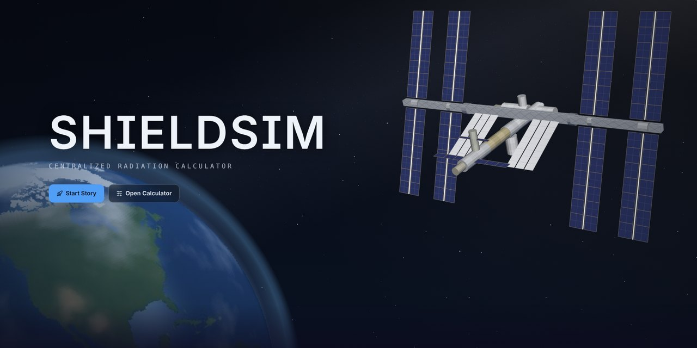
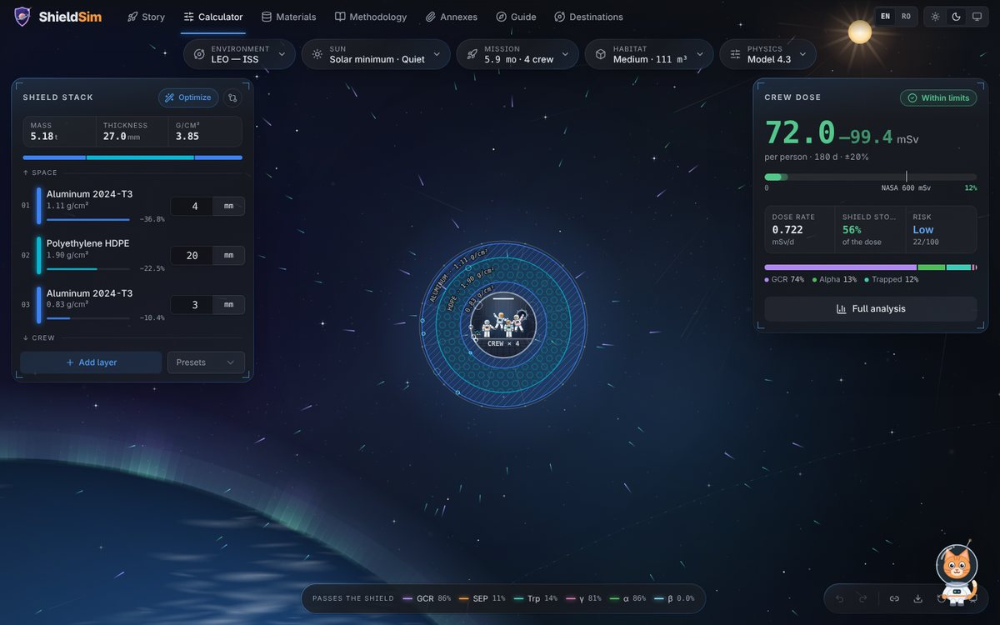
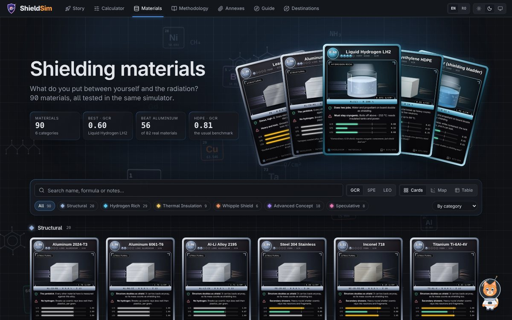
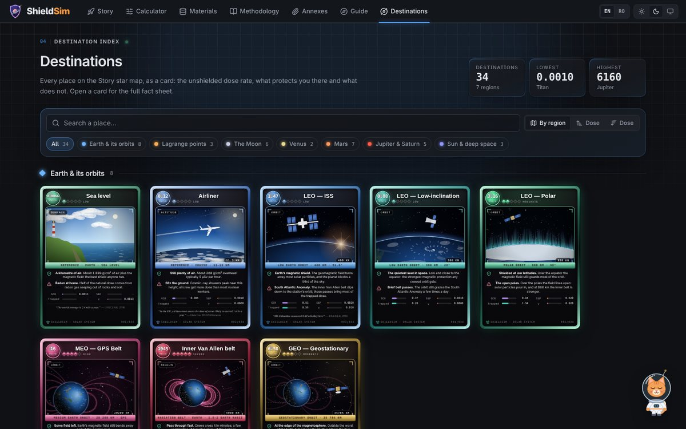
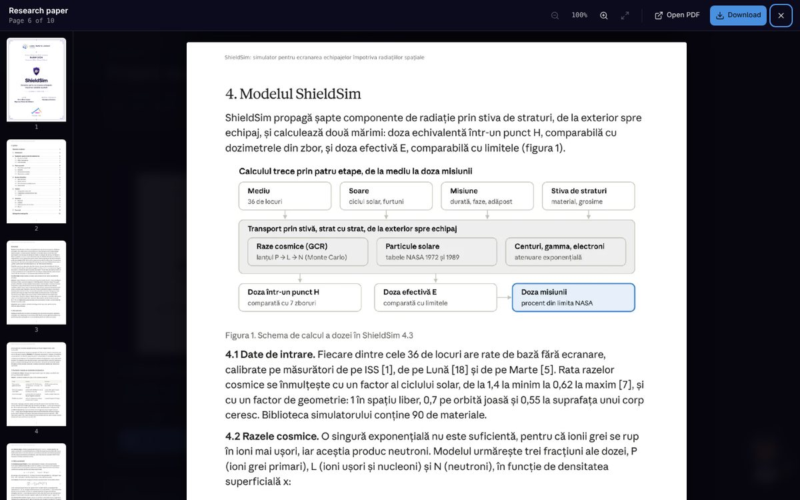
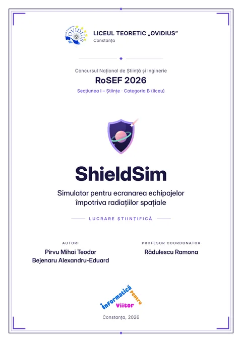
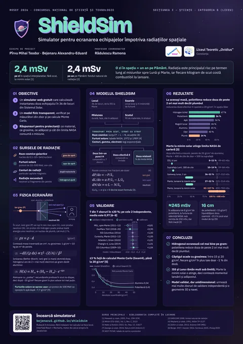
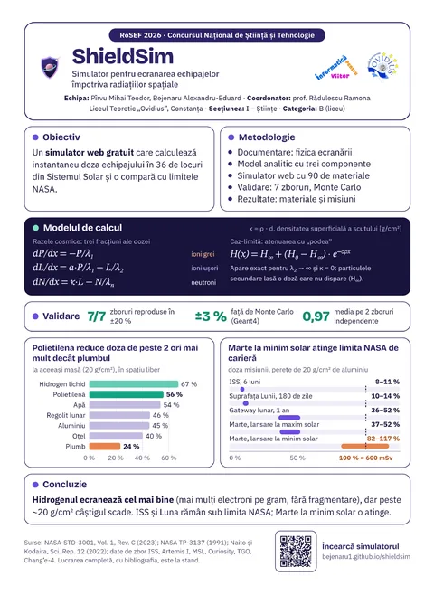

# ShieldSim

**How much space radiation reaches a crew behind a given wall, and which wall protects best for its mass?**

An interactive calculator of crew radiation dose behind multilayer shielding at 36 places in the Solar System, 
from the ISS to the surface of Mars. Runs in the browser, works offline, in English and Romanian.

[-06B6D4?style=for-the-badge&logo=readthedocs&logoColor=white)](paper/ShieldSim-lucrare.pdf)

[Română ↓](#română)

---

## What it does

You choose **where** (36 environments: low Earth orbit, lunar Gateway, Moon, Mars transit, Mars surface, Europa, Titan…), **when** (solar-cycle phase and an optional solar storm, up to a Carrington-class event) and **the wall** (any stack of layers from 90 materials: aluminium, polyethylene, water, regolith, lithium hydride, lead…). ShieldSim returns, instantly:

- the **dose per day and per mission**, as dose equivalent *H* (what a dosimeter reads) and effective dose *E* (what astronaut limits apply to), with an uncertainty band;
- the split by **radiation type**: galactic cosmic rays, solar particles, trapped belts, secondary neutrons, gamma, electrons;
- how much **each layer** removes, the shield's **mass per m²**, and how much of **NASA's 600 mSv career limit** the mission uses;
- engineering warnings (for example, a heavy-metal layer that makes neutrons) and a printable report.

<table>
  <tr>
    <td width="50%"> <b>Calculator.</b> Build the wall layer by layer and read the crew dose.</td>
    <td width="50%"> <b>Materials.</b> 90 materials, all tested in the same model.</td>
  </tr>
  <tr>
    <td width="50%"> <b>Destinations.</b> Every place as a card: unshielded dose and what protects you there.</td>
    <td width="50%"> <b>Annexes.</b> The paper, poster and judges' sheet, with a page viewer.</td>
  </tr>
</table>

There is also a **Story** mode (pick a destination, build the shield, fly the mission and get a dose report) and **Nova**, an assistant that answers questions about radiation and can run the model for you.

## Key results

Behind **20 g/cm²** of material, in free space, the effective dose from cosmic rays drops by:

| Material | Liquid H₂ | Polyethylene | LiH | Water | CFRP | Regolith | Aluminium | Steel | Copper | Tungsten | Lead |
|---|---|---|---|---|---|---|---|---|---|---|---|
| Dose reduction | **67 %** | **56 %** | 56 % | 54 % | 48 % | 46 % | 45 % | 40 % | 39 % | 26 % | 24 % |

At the same mass, **hydrogen-rich materials shield best**: hydrogen has twice as many electrons per gram as aluminium and does not fragment. Polyethylene removes more than twice as much dose as lead. The gain shrinks with thickness: between 15 and 20 g/cm², each extra g/cm² removes only about 1 %.

Missions behind a 20 g/cm² aluminium wall (effective dose, model value to conservative value):

| Mission | Effective dose | Share of NASA's 600 mSv limit |
|---|---|---|
| ISS, 6 months | 49–65 mSv | 8–11 % |
| Lunar surface, 180 days | 59–84 mSv | 10–14 % |
| Lunar Gateway, 1 year | 217–310 mSv | 36–52 % |
| Mars (400 days in flight + 500 on the surface), solar maximum | 221–314 mSv | 37–52 % |
| Same mission, **solar minimum** | **492–703 mSv** | **82–117 %** |

## How the model works

Every radiation component is carried through the wall, layer by layer, as a function of areal density *x* = ρ·d (g/cm²). For galactic cosmic rays a single exponential is not enough, because heavy ions break into lighter ions, which then make neutrons. ShieldSim follows three parts of the dose, primaries *P*, light fragments *L* and neutrons *N*:

$$
\frac{dP}{dx} = -\frac{P}{\lambda_1}, \qquad
\frac{dL}{dx} = \frac{a\,P}{\lambda_1} - \frac{L}{\lambda_2}, \qquad
\frac{dN}{dx} = \kappa L - \frac{N}{\lambda_n}
$$

With λ₂ → ∞ and κ = 0 the solution reduces exactly to the familiar attenuation law with a "floor" of secondaries, $H(x) = H_\infty + (H_0 - H_\infty)\,e^{-\sigma x}$.

- **Effective dose** parameters are fitted to published Geant4 transport results (Naito & Kodaira 2022) for aluminium and polyethylene; other materials follow from their hydrogen content and atomic number.
- **Dose equivalent** (the dosimeter curve) keeps the shape of the transport codes and is fitted to the Artemis I and MSL flight data.
- **Solar storms** come from NASA's dose–depth tables for the August 1972 and October 1989 events, added once per mission.
- **Solar cycle**: cosmic-ray dose × 1.4 at solar minimum and × 0.62 at maximum (Mewaldt et al. 2005).

## Validation

| Check | Result |
|---|---|
| Geant4 depth–dose curves, up to 20 g/cm² | within **±3 %** (full simulator ±5 %) |
| Seven spaceflight measurements | all within **±20 %** |
| The two fully independent flights | geometric mean of model / measured **0.97** |

| Flight | Role in the model | Model / measured |
|---|---|---|
| ISS Columbus, 2016 | calibration | ×1.00 |
| Curiosity, Mars surface, 2012–13 | calibration | ×1.00 |
| Chang'e-4, lunar surface, 2019 | calibration | ×1.01 |
| MSL, cruise to Mars, 2011–12 | fit of the curve shape | ×0.81 |
| Artemis I, Orion, 2022 | fit of the curve shape | ×1.01 |
| **ISS Columbus, 2009–10** | **independent validation** | **×1.04** |
| **ExoMars TGO, 2018–20** | **independent validation** | **×0.90** |

**Limits.** ShieldSim is a one-dimensional model for education and early trade studies. It does not reproduce the ~30 % drop in dose measured on Artemis I between 25 and 45 g/cm² (the model gives ~10 %), only two flights validate it independently, and it does not replace full transport codes (Geant4, PHITS, FLUKA, HZETRN/OLTARIS) for a real spacecraft.

## Documents

<table>
  <tr>
    <td align="center" width="33%"> <b>Research paper</b> A4 · 10 pages · Romanian</td>
    <td align="center" width="33%"> <b>Poster</b> A1 · Romanian</td>
    <td align="center" width="33%"> <b>Judges' sheet</b> A4 · Romanian</td>
  </tr>
</table>

They can also be read page by page in the **[Annexes tab](https://bejenaru1.github.io/shieldsim/#/annexes)** of the site.

## Main sources

Naito & Kodaira, *Sci. Rep.* 12, 13617 (2022) · Norman et al., NASA NTRS 20170005580 (2017) · Berger et al., *J. Space Weather Space Clim.* 7, A8 (2017) · Hassler et al., *Science* 343, 1244797 (2014) · Zeitlin et al., *Science* 340, 1080 (2013) · Zhang et al., *Sci. Adv.* 6, eaaz1334 (2020) · George et al., *Nature* 634, 48 (2024) · Semkova et al., EPSC2020-50 · Weyland et al., NASA TP-3137 (1991) · Mewaldt et al., 29th ICRC (2005) · NASA-STD-3001 Vol. 1 Rev. C (2023). The full bibliography is in the paper.

## About this repository

This repository hosts the **built site** served by GitHub Pages: `index.html` is the whole application in a single file (interface, physics engine and data), `paper/` holds the documents and their page previews. The site is installable on a phone ("Add to Home Screen") and keeps working offline.

## Authors

**Pîrvu Mihai Teodor** and **Bejenaru Alexandru-Eduard** 
Coordinating teacher: prof. **Rădulescu Ramona** 
Liceul Teoretic „Ovidius”, Constanța, Romania · RoSEF 2026, Section I – Sciences, Category B

**Use of AI.** Claude (Anthropic) was used as an assistant to help write and debug the application code and to design the interface. Nova, the in-app assistant, runs a local language model. The choice of model and data and the checking of the results against the cited sources were done by the authors.

## Cite and license

Use the **“Cite this repository”** button in the sidebar ([`CITATION.cff`](CITATION.cff)). Code: [MIT](LICENSE). Data and documentation: [CC BY 4.0](LICENSE-DATA).

---

## Română

**ShieldSim** este un calculator interactiv al dozei de radiație primite de un echipaj în spatele unui scut cu mai multe straturi, în 36 de locuri din Sistemul Solar. Alegi locul, faza ciclului solar (și o eventuală furtună solară) și peretele, din 90 de materiale; simulatorul dă imediat doza pe zi și pe misiune, defalcată pe tipuri de radiație, și cât din limita de carieră a NASA (600 mSv) consumă misiunea. Rulează în browser, fără instalare, și funcționează fără internet.

- **Modelul:** trei componente pentru razele cosmice (ioni primari → fragmente ușoare → neutroni), ajustate pe calcule Geant4 publicate; furtunile solare din tabelele NASA ale evenimentelor din 1972 și 1989.
- **Validarea:** ±3 % față de Geant4 până la 20 g/cm²; toate cele șapte măsurători de zbor în ±20 %; pe cele două zboruri independente (ISS 2009–10, ExoMars TGO), media geometrică model / măsurătoare este 0,97.
- **Rezultatul principal:** la aceeași masă, materialele bogate în hidrogen ecranează cel mai bine: în spatele a 20 g/cm², polietilena reduce doza cu 56 %, aluminiul cu 45 %, plumbul doar cu 24 %. O misiune pe Marte la minim solar se apropie de limita NASA (82–117 %).

**Deschide simulatorul:** <https://bejenaru1.github.io/shieldsim/> · **Lucrarea, posterul și fișa pentru jurați:** în tab-ul [Anexe](https://bejenaru1.github.io/shieldsim/#/annexes) sau în folderul [`paper/`](paper/).

**Autori:** Pîrvu Mihai Teodor și Bejenaru Alexandru-Eduard · **Profesor coordonator:** prof. Rădulescu Ramona · Liceul Teoretic „Ovidius”, Constanța · RoSEF 2026, Secțiunea I – Științe, Categoria B.

**Folosirea AI.** Claude (Anthropic) a fost folosit ca asistent pentru scrierea și depanarea codului aplicației și pentru designul interfeței. Nova, asistentul din aplicație, rulează un model de limbaj local. Alegerea modelului și a datelor, precum și verificarea rezultatelor față de sursele citate au fost făcute de autori.
