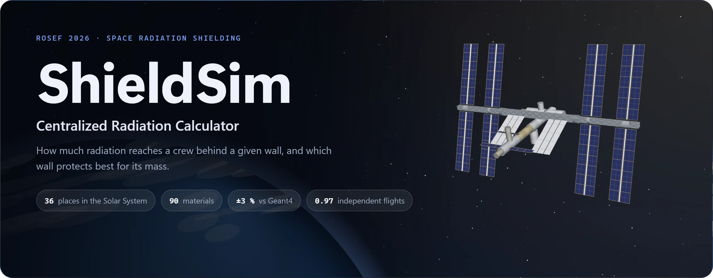
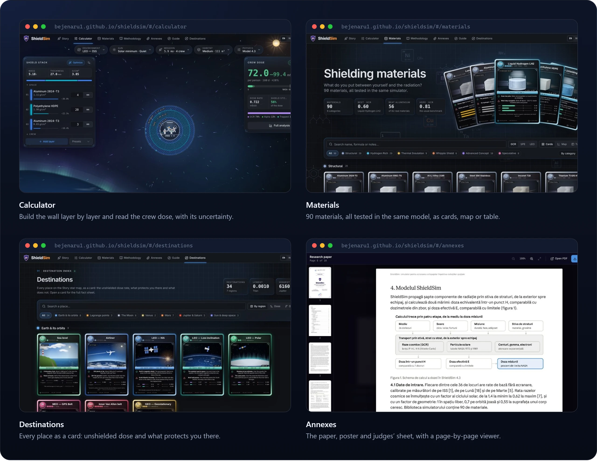
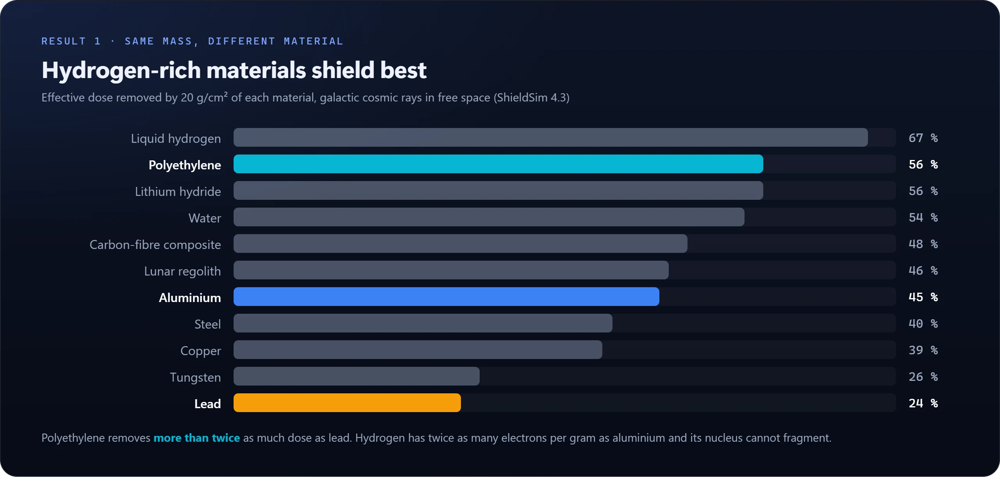
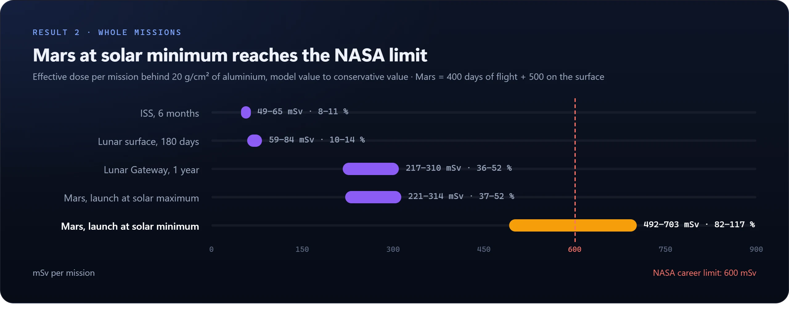
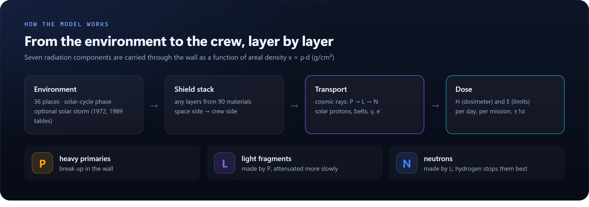
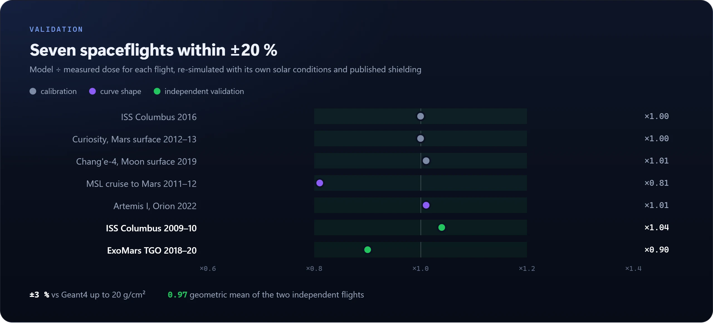
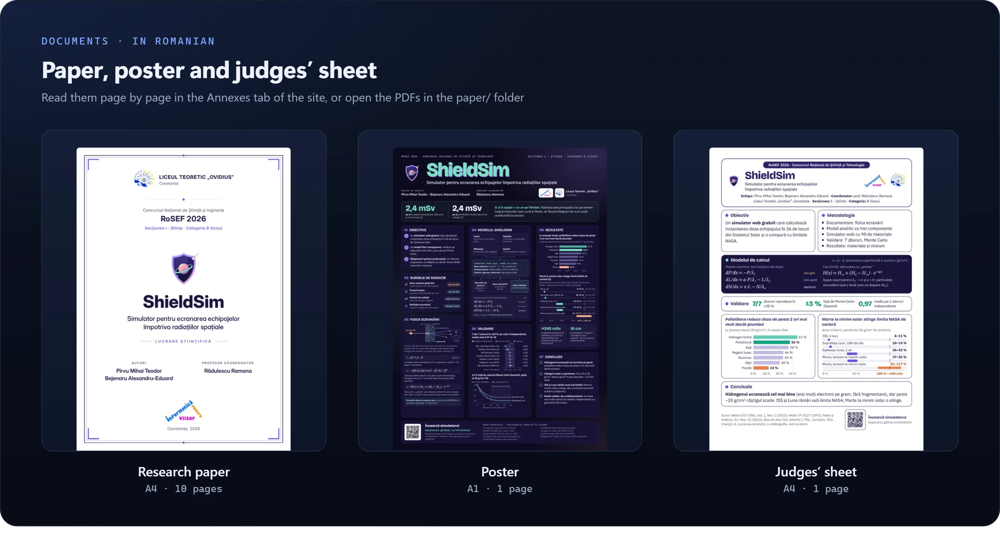

  

  &nbsp;&nbsp;
  &nbsp;&nbsp;
  

  Model 4.3.0 · RoSEF 2026 · English and Romanian · works offline · <a href="#română">Română ↓</a>

 

ShieldSim is a calculator of the radiation dose a crew receives behind a multilayer wall, at **36 places in the Solar System**, from the ISS to the surface of Mars. You choose **where** (low Earth orbit, lunar Gateway, Moon, Mars transit, Europa, Titan…), **when** (solar-cycle phase and an optional solar storm, up to a Carrington-class event) and **the wall** (any stack of layers from **90 materials**). It answers instantly with:

- the **dose per day and per mission**, as dose equivalent *H* (what a dosimeter reads) and effective dose *E* (what astronaut limits apply to), with an uncertainty band;
- the split by **radiation type**: galactic cosmic rays, solar particles, trapped belts, secondary neutrons, gamma, electrons;
- what **each layer** removes, the **mass per m²** of the wall, and the share of **NASA's 600 mSv career limit** the mission uses.

  

It also has a **Story** mode (choose a destination, build the shield, fly the mission, get a dose report) and **Nova**, an assistant that answers questions about radiation and runs the model for you.

## Results

  

  

At the same mass, **hydrogen-rich materials shield best**, and the gain shrinks with thickness: between 15 and 20 g/cm², each extra g/cm² removes only about 1 %. A Mars mission launched at **solar minimum** comes close to NASA's career limit; launching at solar maximum halves the cosmic-ray dose but needs a storm shelter.

<b>Data tables</b>

 

| Material (20 g/cm²) | Liquid H₂ | Polyethylene | LiH | Water | CFRP | Regolith | Aluminium | Steel | Copper | Tungsten | Lead |
|---|---|---|---|---|---|---|---|---|---|---|---|
| Dose removed | 67 % | 56 % | 56 % | 54 % | 48 % | 46 % | 45 % | 40 % | 39 % | 26 % | 24 % |

| Mission, 20 g/cm² aluminium | Effective dose | Share of 600 mSv |
|---|---|---|
| ISS, 6 months | 49–65 mSv | 8–11 % |
| Lunar surface, 180 days | 59–84 mSv | 10–14 % |
| Lunar Gateway, 1 year | 217–310 mSv | 36–52 % |
| Mars (400 d flight + 500 d surface), solar maximum | 221–314 mSv | 37–52 % |
| Same mission, solar minimum | 492–703 mSv | 82–117 % |

## How the model works

  

A single exponential is not enough for galactic cosmic rays: heavy ions break into lighter ions, which then make neutrons. ShieldSim follows the three parts of the dose through each layer of areal density *x*:

$$
\frac{dP}{dx} = -\frac{P}{\lambda_1}, \qquad
\frac{dL}{dx} = \frac{a\,P}{\lambda_1} - \frac{L}{\lambda_2}, \qquad
\frac{dN}{dx} = \kappa L - \frac{N}{\lambda_n}
$$

With λ₂ → ∞ and κ = 0 this reduces exactly to the familiar attenuation law with a "floor" of secondaries, $H(x) = H_\infty + (H_0 - H_\infty)\,e^{-\sigma x}$.

- **Effective dose** parameters are fitted to published Geant4 results (Naito & Kodaira 2022) for aluminium and polyethylene; other materials follow from their hydrogen content and atomic number.
- **Dose equivalent** keeps the shape of the transport codes and is fitted to the Artemis I and MSL flight data.
- **Solar storms** come from NASA's dose–depth tables for August 1972 and October 1989, added once per mission.
- **Solar cycle**: cosmic-ray dose × 1.4 at solar minimum and × 0.62 at maximum (Mewaldt et al. 2005).

## Validation

  

**Limits.** ShieldSim is a one-dimensional model for education and early design studies. It does not reproduce the ~30 % drop in dose measured on Artemis I between 25 and 45 g/cm² (the model gives ~10 %), only two flights validate it independently, and it does not replace full transport codes (Geant4, PHITS, FLUKA, HZETRN/OLTARIS) for a real spacecraft.

## Documents

  

  PDF: <a href="paper/ShieldSim-lucrare.pdf">research paper</a> · <a href="paper/ShieldSim-poster-A1.pdf">poster</a> · <a href="paper/ShieldSim-fisa-A4.pdf">judges' sheet</a>

## Download

The **Download** button at the top right of the site offers the same two packages:

| | What you get | Link |
|---|---|---|
| **Website only** | `ShieldSim.html` and the documents. Opens with a double-click in any browser, on Windows, macOS or Linux, without internet. Nova answers only the common questions. | [ShieldSim-offline.zip](https://bejenaru1.github.io/shieldsim/download/ShieldSim-offline.zip) |
| **Website + AI assistant** (Windows) | Installs the site, [Ollama](https://ollama.com) and the AI model (qwen3:8b), with a Desktop shortcut; Nova then answers any question offline. Each start checks for a new version and asks before updating. Needs Windows 10/11, 16 GB RAM recommended, ~8 GB free. | [ShieldSim-AI-Windows.zip](https://bejenaru1.github.io/shieldsim/download/ShieldSim-AI-Windows.zip) |

## Sources

Naito & Kodaira, *Sci. Rep.* 12, 13617 (2022) · Norman et al., NASA NTRS 20170005580 (2017) · Berger et al., *J. Space Weather Space Clim.* 7, A8 (2017) · Hassler et al., *Science* 343, 1244797 (2014) · Zeitlin et al., *Science* 340, 1080 (2013) · Zhang et al., *Sci. Adv.* 6, eaaz1334 (2020) · George et al., *Nature* 634, 48 (2024) · Semkova et al., EPSC2020-50 · Weyland et al., NASA TP-3137 (1991) · Mewaldt et al., 29th ICRC (2005) · NASA-STD-3001 Vol. 1 Rev. C (2023). The full bibliography is in the paper.

## About this repository

This repository hosts the **built site** served by GitHub Pages: `index.html` is the whole application in one file (interface, physics engine and data), `paper/` holds the documents and their page previews, and `download/` the offline packages and the files the Windows installer keeps in sync.

## Authors

**Pîrvu Mihai Teodor** and **Bejenaru Alexandru-Eduard** · coordinating teacher: prof. **Rădulescu Ramona** 
Liceul Teoretic „Ovidius”, Constanța, Romania · RoSEF 2026, Section I – Sciences, Category B

**Use of AI.** Claude (Anthropic) was used as an assistant to help write and debug the application code and to design the interface. Nova, the in-app assistant, runs a local language model. The choice of model and data and the checking of the results against the cited sources were done by the authors.

**Cite** with the “Cite this repository” button ([`CITATION.cff`](CITATION.cff)). **License:** code [MIT](LICENSE); data and documentation [CC BY 4.0](LICENSE-DATA).

 

## Română

**ShieldSim** este un calculator al dozei de radiație primite de un echipaj în spatele unui scut cu mai multe straturi, în 36 de locuri din Sistemul Solar. Alegi locul, faza ciclului solar (și o eventuală furtună solară) și peretele, din 90 de materiale; simulatorul dă imediat doza pe zi și pe misiune, defalcată pe tipuri de radiație, și cât din limita de carieră a NASA (600 mSv) consumă misiunea. Rulează în browser, fără instalare, și funcționează fără internet.

- **Modelul:** trei componente pentru razele cosmice (ioni primari → fragmente ușoare → neutroni), ajustate pe calcule Geant4 publicate; furtunile solare din tabelele NASA ale evenimentelor din 1972 și 1989.
- **Validarea:** ±3 % față de Geant4 până la 20 g/cm²; toate cele șapte măsurători de zbor în ±20 %; pe cele două zboruri independente (ISS 2009–10, ExoMars TGO), media geometrică model / măsurătoare este 0,97.
- **Rezultatul principal:** la aceeași masă, materialele bogate în hidrogen ecranează cel mai bine: în spatele a 20 g/cm², polietilena reduce doza cu 56 %, aluminiul cu 45 %, plumbul doar cu 24 %. O misiune pe Marte la minim solar se apropie de limita NASA (82–117 %).

**Deschide simulatorul:** <https://bejenaru1.github.io/shieldsim/> · **Documentele:** tab-ul [Anexe](https://bejenaru1.github.io/shieldsim/#/annexes) sau folderul [`paper/`](paper/) · **Descărcare:** butonul „Descarcă” din dreapta sus a site-ului.

**Autori:** Pîrvu Mihai Teodor și Bejenaru Alexandru-Eduard · **Profesor coordonator:** prof. Rădulescu Ramona · Liceul Teoretic „Ovidius”, Constanța · RoSEF 2026, Secțiunea I – Științe, Categoria B.

**Folosirea AI.** Claude (Anthropic) a fost folosit ca asistent pentru scrierea și depanarea codului aplicației și pentru designul interfeței. Nova, asistentul din aplicație, rulează un model de limbaj local. Alegerea modelului și a datelor, precum și verificarea rezultatelor față de sursele citate au fost făcute de autori.
